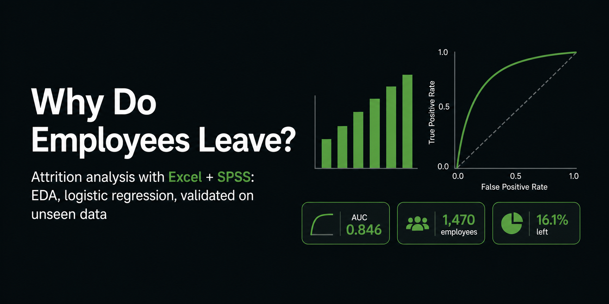

# Why Do Employees Leave? Employee Attrition Analysis (Excel + SPSS)



An end-to-end analysis of the IBM HR Analytics Employee Attrition dataset: exploratory charts in Excel, statistical tests and a logistic regression in SPSS, validated on a held-out test set.

**Full write-up (PDF, with all figures):** [`Why_Do_Employees_Leave_V_Final.pdf`](Why_Do_Employees_Leave_V_Final.pdf)

> **Note:** the dataset is fictional (created by IBM data scientists). The findings describe this dataset only and are **associations, not causes**.

## Headline results
- 1,470 employees, 237 leavers (**16.1%** attrition).
- **Overtime** is the clearest signal: 30.5% of people working overtime left vs 10.4% of those who don't (Cramér's V = 0.246). Job role is almost as strong (V = 0.242); department is the weakest (V = 0.086).
- Entry-level employees left most (26.3%); the top two levels left least (4.7% and 7.3%).
- Logistic regression (22 parameters), fitted on a 70% training set: **test AUC 0.846** (95% CI 0.793 to 0.900), training AUC 0.848.
- At cutoff 0.268 (chosen on the training set only), test sensitivity is 58.5% and specificity 88.1%.

## Repository contents
```
README.md
Why_Do_Employees_Leave_V_Final.pdf   full report
data/                                dataset (.csv and .sav), see "Data source"
excel/                               Excel workbook: charts and pivot tables (EDA)
spss/attrition_final_model.sps       syntax for the final model, ROC and cutoff
images/                              figures used in the report
```

## Data source
IBM HR Analytics Employee Attrition & Performance, a public sample dataset created by IBM data scientists. Source: [add link to the page you downloaded it from]. Please check the license there before reusing the data.
Constant columns (EmployeeCount, StandardHours, Over18) were excluded.

## Methods

### 1. Exploratory analysis: the right test for each data type
| Variables | Test | Effect size |
|---|---|---|
| Nominal vs Attrition | Chi-square | Cramér's V |
| Ordinal vs Attrition | Mann-Whitney U | r = Z/√N |
| Scale vs Scale | Pearson, checked against Spearman | r |
| Scale by groups | Two-way ANOVA (income by attrition and job level) | partial η² |

Effect sizes are reported next to p-values because with n = 1,470 almost everything is "significant".

| Question | Result |
|---|---|
| Job role | p < .001, V = 0.242 |
| Overtime | χ²(1) = 89.04, p < .001, V = 0.246 |
| Business travel | χ²(2) = 24.18, p < .001, V = 0.128 |
| Department | χ²(2) = 10.80, p = .005, V = 0.086 |
| Job level (Mann-Whitney) | Z = −7.30, r ≈ 0.19 |
| Job involvement (Mann-Whitney) | Z = −4.58, r ≈ 0.12 |
| Job satisfaction (Mann-Whitney) | Z = −3.95, r ≈ 0.10 |

### 2. Assumption checks (income ANOVA)
- Raw MonthlyIncome is clearly non-normal (floor and cap), but the model residuals were approximately normal.
- Residual spread was unequal across job levels, so the interaction was confirmed with robust (HC3) standard errors.
- Job level explains most of the income (partial η² = .81); attrition alone explains almost nothing (.006). Money follows job level, consistent with the 0.92 JobLevel–MonthlyIncome correlation.

### 3. Logistic regression
1. **Multicollinearity:** VIF below 1.5 for all predictors.
2. **Linearity of the logit (Box-Tidwell):** satisfaction variables were not linear, so they were treated as categorical.
3. **Merged sparse categories:** JobLevel 4 and 5; Manager and Research Director; HR and Sales Representative; EnvironmentSatisfaction 2 and 3; JobSatisfaction 1 to 3 vs 4; StockOptionLevel 1 and 2.
4. **Dropped weak predictors:** Age and RelationshipSatisfaction. This reduced the model from 30 to 22 parameters with about the same AUC (change of about 0.01).
5. **Split:** 70% training (1,060 employees, 172 leavers) and 30% test (410 employees, 65 leavers). The model was fitted on the training set only; test employees were scored with the training model.

Final model (training set): omnibus χ²(22) = 276.9, p < .001; Nagelkerke R² = .391; 7.8 events per parameter.

Odds ratios (95% CI). Reference categories: JobRole = Sales Executive, BusinessTravel = Travel_Frequently, StockOptionLevel = 0, JobLevel = 1, JobInvolvement = 1, EnvironmentSatisfaction = 1.

| Predictor | OR | 95% CI |
|---|---|---|
| OverTime: yes vs no | 4.99 | 3.31 to 7.53 |
| YearsWithCurrManager (per year) | 0.90 | 0.83 to 0.97 |
| YearsSinceLastPromotion (per year) | 1.09 | 1.01 to 1.19 |
| BusinessTravel: Travel_Rarely | 0.54 | 0.34 to 0.87 |
| BusinessTravel: Non-Travel | 0.22 | 0.09 to 0.53 |
| JobInvolvement: level 2 / 3 / 4 | 0.44 / 0.27 / 0.15 | see report |
| EnvironmentSatisfaction: levels 2+3 / level 4 | 0.32 / 0.22 | see report |
| JobSat_High (level 4 vs 1 to 3) | 0.49 | 0.32 to 0.77 |
| StockOptionLevel: levels 1+2 | 0.28 | 0.18 to 0.43 |
| JobRole (overall) | Wald = 38.5, p < .001 | see report |

Odds ratios are not risk ratios: an OR of about 5 for overtime means the *odds* of leaving are about 5 times higher, other variables held fixed. The unadjusted odds ratio from the crosstab is about 3.8. The full table is in the report.

## Validation
| | Training | Test |
|---|---|---|
| AUC | 0.848 (95% CI 0.814 to 0.883) | **0.846** (95% CI 0.793 to 0.900) |

### Classification at a chosen cutoff
The default 0.50 cutoff is too high for a 16% outcome (test sensitivity only 26.2%). The cutoff **0.268** was chosen **on the training set only** by maximising Youden's J.

| At cutoff 0.268 | Training | Test |
|---|---|---|
| Sensitivity | 66.9% (115/172) | 58.5% (38/65) |
| Specificity | 88.3% (784/888) | 88.1% (304/345) |
| Precision | 52.5% | 48.1% (38/79), about 3 times the base rate of 15.9% |

Accuracy is not a useful metric here: test accuracy is 83.4%, slightly below the always-"stay" baseline (84.1%).

## A mistake worth mentioning
My first "test AUC" was 0.900. I had accidentally **refitted the model on the test employees** instead of scoring them with the training model. After correcting it, the test AUC is 0.846. The story is in Chapter 5 of the report.

## Limitations
- **Few events per parameter:** 7.8 (guideline: 10 to 15), so some estimates are imprecise.
- **Mild selection leak:** variables were selected, and the JobRole and JobLevel merges decided, using all 1,470 rows before the split, so test results are slightly optimistic. The later merges, the dropped variables and the cutoff used the training set only.
- **Calibration:** Hosmer-Lemeshow is significant on the training set (p < .001), mostly from one low-risk decile. The model ranks risk well but its probabilities are not perfectly calibrated. Test-set calibration was not assessed.
- **Small test set:** 65 test leavers, so AUC and sensitivity are imprecise and a single split is unstable.
- **Cutoff:** Youden's J weighs both error types equally; a real application should use the relative costs.
- Many exploratory tests with no multiple-testing correction. Fictional data, association only.

## How to reproduce
1. Open the `.sav` file in `data/` in SPSS. It already contains the recoded variables (`JobRole_Final`, `JobLevel_Final`, `JobSat_Final`, `StockOptionLevel_Final`, `EnvironmentSatisfaction_Final`) and the `split` variable (1 = training, 0 = test).
2. Run `spss/attrition_final_model.sps`. It fits the final model on the training rows, saves predicted probabilities, runs the ROC curves for train and test, and produces the crosstabs at cutoff 0.268.
3. The earlier steps (EDA tests, ANOVA, category merging) were run through the SPSS menus and are described in the report; their syntax was not saved.

## Next steps
- 5-fold stratified cross-validation.
- Calibration plot and Brier score; an OverTime × JobLevel interaction.
- Reproduce the analysis in Python (pandas, scikit-learn) and compare with a random forest using SHAP.
- Power BI dashboard and the same crosstabs in SQL.

## Tools
Excel, SPSS. Python, Power BI and SQL planned for later versions.

## Feedback welcome
I'm learning in public. Corrections, suggestions and critique are appreciated: please open an issue.
